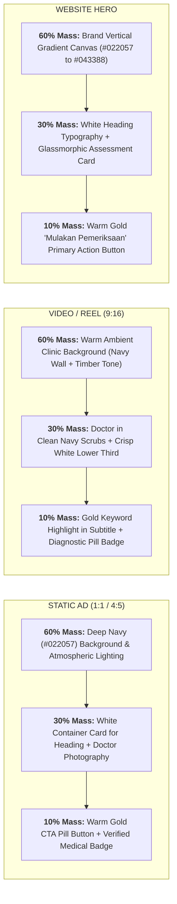

# SS Clinic Brand Positioning: Designer & Editor Playbook

> **Looking for the logo, colours or rules?** Start with the [SS Clinic guideline page](/products/ssclinic/). This document is the full positioning: taglines, tone of voice and the designer's field guide.

<details class="doc-details">
<summary>Document details</summary>

**Document ID:** `SSC-STR-001`  
**Entity:** SuamiSihat Clinic Sdn. Bhd. (SSC)  
**Target Audience:** Creative Directors, UI/UX Designers, Motion Editors, Healthcare Copywriters  
**Classification:** Brand-level standard. Competitor analysis, regional playbooks, swipe files and the review gate are staff-only.  

</details>

---

## Brand Summary

SuamiSihat Clinic Sdn. Bhd. (02-SSC) is a men's health clinic brand built around the Malaysian husband: dignified, expert and brotherly. Its core directive is **"Kami Tak Jual Rawatan. Kami Cari Punca."** The clinic checks first, treats with precision and makes no false promises.

Visually that means deep navy and white with a restrained warm accent, calm clinical photography and plain, respectful Malay. It never uses shame, fear or false urgency.

---

## Tagline Architecture

| Level | Use | Line |
| :--- | :--- | :--- |
| 1. Brand mantra | Internal north star | *"Sihat Dari Dalam. Kuat Untuk Semua."* |
| 2. Campaign tagline | All external touchpoints | *"Jaga Enjin. Jaga Keluarga."* |
| 4. Standard closer | Closing line | *"Suami Sihat, Keluarga Bahagia."* |

Treatment-specific lines (level 3) are held in the staff-only playbook until regulatory review is complete.

### Core Verbal Assets

* **Primary tagline (all touchpoints):**
  > **"Kami Tak Jual Rawatan. Kami Cari Punca."**  
  > *(We don't sell treatments. We find the root cause.)*

* **The 3-point brand promise:**
  > **"Check Dulu. Rawat Dengan Tepat. Tiada Janji Palsu."**  
  > *(Use on website hero banners, pinned posts, WhatsApp bios and clinic signage.)*

---

## Part 1: Designer's Field Guide (Visual Art Direction & UI/UX Standards)

This section provides strict, non-negotiable art-direction specifications for graphic designers, digital art directors, and UI/UX engineers building assets for SuamiSihat® Clinic.

### 01. The 60:30:10 Color Hierarchy & Token Specification

The 60:30:10 rule is an **art-direction heuristic for visual mass**. It guarantees that every asset communicates medical authority, premium refinement, and clinical hygiene.

```text
┌─────────────────────────────────────────────────────────────────────────────┐
│                        60:30:10 VISUAL MASS DISTRIBUTION                    │
├──────────────────────────────┬──────────────────────────────┬───────────────┤
│    60% FOUNDATION BASE       │    30% SECONDARY STRUCTURE   │ 10% ACCENT    │
│    Deep Navy Canvas          │    Clinical White & Slate    │ Warm Gold/Cyan│
│    #022057 / #0F4C75         │    #FFFFFF / #F8FAFC         │ #F4A261 / #21A│
│                              │                              │               │
│    Clinical Authority,       │    Sterile Hygiene, Content  │ CTAs, Badges, │
│    Trust, Male Dignity       │    Containers, Legibility    │ Conversions   │
└──────────────────────────────┴──────────────────────────────┴───────────────┘
```

#### Official Semantic Color Tokens

| Role | Color Name | Hex Code | Semantic Design Token | Usage Scope |
| :--- | :--- | :--- | :--- | :--- |
| **60% Foundation** | Deep Prussian Navy | `#022057` | `--color-brand-deep` | Master hero background, solid poster canvas, header panels. |
| **30% Structure** | Clinical Navy | `#0F4C75` | `--color-brand-primary` | In-clinic acrylic walls, video backdrops, gradient overlays. |
| **30% Structure** | Pure Clinical White | `#FFFFFF` | `--color-neutral-bg-1` | Content cards, data containers, main text on dark surfaces. |
| **30% Structure** | Sterile Off-White | `#F8FAFC` | `--color-neutral-bg-2` | Light web canvas, alternating table rows, card borders. |
| **30% Structure** | Slate Border | `#E2E8F0` | `--color-neutral-stroke-1` | Card dividers, subtle outline strokes, input field borders. |
| **10% Brand Accent** | Warm Clinic Gold | `#F4A261` | `--color-accent-gold` | Primary conversion CTAs (`MULAKAN PEMERIKSAAN`), star ratings, quiz highlight badges. |
| **10% Brand Accent (Alt)** | Azure Energy | `#21A1F7` | `--color-brand-light` | Digital active states, diagnostic wave pulses, verified ticks. |
| **Text Primary (Light)**| Neutral Black | `#1C1C1C` | `--color-neutral-fg-1` | High-contrast body and heading copy on white or light cards. |

> [!WARNING]
> **Strict Color Blacklist for Designers:**
> - {{icon:no}} **NEVER use Aggressive Alarm Red (`#FF0000` / `#DC2626`)** in ad banners, hero headers, or badges. Red triggers medical dread, shame, and associates our clinic with low-tier commoditised rivals.
> - {{icon:no}} **NEVER use Flash-Sale Hazard Yellow (`#FFFF00`)** or bright fluorescent green for promotional banners.
> - {{icon:no}} **NEVER use Harsh Pitch Black (`#000000`)** as a full flat background. Use Deep Prussian Navy (`#022057`) to preserve warmth and clinical depth.

#### Visual Mass Allocation Across Formats



---

### 02. Typography System & Type Scale

SuamiSihat® typography pairs **editorial masculinity with digital precision**.

#### Font Pairings

- **Headlines & Display:** `Poppins` (Primary Display) or `'Segoe UI Variable Display'` (Windows Fluent 2 fallback). Bold, confident, human geometric sans-serif.
- **Body & Microcopy:** `Inter` (Universal UI Standard). Superb legibility at 12px to 16px, balanced numerical figures for clinical test readings.
- **Monospace & Code:** `Cascadia Code` / `Fira Code`. Used exclusively for clinical metrics, lab test values, and Document IDs.

#### Master Type Scale Table

| Level | Size (Desktop / Mobile) | Weight | Line Height | Tracking | Text Color Role |
| :--- | :--- | :--- | :--- | :--- | :--- |
| **Hero H1** | `44px` / `32px` | 800 (ExtraBold) | 1.15 | `-0.025em` | White (`#FFFFFF`) on Navy; Neutral Black (`#1C1C1C`) on Light. |
| **Section H2**| `28px` / `22px` | 700 (Bold) | 1.25 | `-0.02em` | Deep Navy (`#022057`) on Light; Pure White on Dark. |
| **Subhead H3**| `20px` / `18px` | 600 (SemiBold) | 1.35 | `-0.01em` | Clinical Navy (`#043388`) on Light; Azure (`#6DC6EC`) on Dark. |
| **Body Large**| `18px` / `16px` | 400 (Regular) | 1.75 | `0` | Charcoal Grey (`#334155`). |
| **Body Base** | `15px` / `14px` | 400 (Regular) | 1.70 | `0` | Charcoal Grey (`#334155`). |
| **Caption/Tag**| `12px` / `11px` | 600 (SemiBold) | 1.40 | `+0.05em` | Muted Slate (`#64748B`), Uppercase. |

---

### 03. Layout Grid, Corner Radius & Elevation Tokens

All visual assets must conform to Microsoft Fluent 2-aligned structural tokens:

* **Corner Radius:**
  - Cards & Posters: `12px` (`--f-radius-lg`).
  - Buttons & Interactive Pills: `9999px` (Full Pill) or `8px` (`--f-radius-md`).
  - Input Fields: `8px` (`--f-radius-md`).
* **Card Elevation & Shadow:**
  - Default Card: `box-shadow: 0 4px 16px rgba(2, 32, 87, 0.08);`
  - Hover / Active Card: `box-shadow: 0 8px 24px rgba(2, 32, 87, 0.14);`
* **Safe Padding Margins:**
  - 1:1 Static Ads: Minimum `64px` safe margin on all edges.
  - 9:16 Video / Reels: Keep all text overlays inside the central `1080 x 1350 px` safe zone (clear of top status bar and bottom TikTok caption drawer).

---

### 04. Photography & Art Direction: The Casting & Staging Doctrine

```text
┌─────────────────────────────────────────────────────────────────────────────┐
│                      PHOTOGRAPHY CASTING & STAGING DOCTRINE                 │
├──────────────────────────────────────┬──────────────────────────────────────┤
│ APPROVED SUAMISIHAT® VISUALS         │ STRICTLY BANNED VISUAL CLICHÉS       │
├──────────────────────────────────────┼──────────────────────────────────────┤
│ • Dignified Malaysian men (32–55 yo) │ • Distressed men clutching forehead  │
│ • Natural smiles, upright posture    │ • Dark, depressing, gloomy bedrooms  │
│ • Warm eye contact, calm composure   │ • Aggressive bodybuilders / gym bros │
│ • Doctors in modern navy scrubs      │ • Cold, sterile hospital white gowns │
│ • Warm clinic lounge lighting (3000K)│ • Harsh blue/green fluorescent lamps │
│ • Genuine doctor-patient dialogue    │ • Explicit anatomical cross-sections │
│ • High-end diagnostic equipment      │ • Fake pill bottles or loose tablets │
└──────────────────────────────────────┴──────────────────────────────────────┘
```

#### Approved Photography Styles
1. **The Modern Husband Portrait:** Authentic Malaysian men (Malay, Chinese, Indian) engaged in real-life moments: enjoying breakfast with family, driving, working at an executive desk, or sharing coffee. He is confident, respected, and proactive about his health.
2. **The Attentive Physician Portrait:** Clinic doctors photographed in warm, modern clinic consultation suites. Posture is open, listening, and empathetic. Attire: Tailored navy clinical scrubs or crisp modern white consultation coats with embroidered SuamiSihat® insignia.
3. **The Diagnostic Ritual:** Macro photography of high-precision diagnostic tools: digital blood pressure monitors, centrifugal lab tubes, ESWT acoustic handpieces held with professional precision. Focus on the **scientific credibility of diagnosis**.

---

---

## Part 2: Brand Voice

Voice rules for copywriters. Regulatory guardrails, regional playbooks, swipe files, the video playbook and the production review gate are in the staff-only playbook.

### 01. The Brand Voice Matrix: Modern Masculine Healthcare

SuamiSihat® operates under one foundational standard: **MASCULINE ≠ MACHO**.

```text
┌─────────────────────────────────────────────────────────────────────────────┐
│                        BRAND VOICE BOUNDARY MATRIX                          │
├──────────────────────────────────────┬──────────────────────────────────────┤
│ WHAT SUAMISIHAT® IS                  │ WHAT SUAMISIHAT® IS NOT              │
├──────────────────────────────────────┼──────────────────────────────────────┤
│ [ Warm, brotherly, respected peer  ] │ [ Cold, clinical, preaching doctor ] │
│ [ Educated, conversational Malay   ] │ [ Rigid archaic BM or crude slang  ] │
│ [ "Sinyal semulajadi badan..."     ] │ [ "MATI PUCUK?! RAWAT SEGERA!"     ] │
│ [ Systemic engine optimisation     ] │ [ Deficit fixing & performance panic]│
│ [ "Seorang suami bertanggungjawab" ] │ [ "A patient with sexual dysfunction"]│
│ [ "Mulakan Pemeriksaan Awal"       ] │ [ "Cepat book! Tinggal 2 slot!"    ] │
│ [ Evidence-grounded root cause     ] │ [ Unsubstantiated miracle cures    ] │
└──────────────────────────────────────┴──────────────────────────────────────┘
```

---

---

---

## Related Documentation & Design System Cross-References

- **Brand Voice & Editorial Standards:** [Brand Voice Guide](/doc/?doc=brand-voice)
- **Colour Composition Standard (60:30:10):** [Colour Composition Guide](/doc/?doc=color-composition-guide)
- **Hero Banner Standard (`ss-hero`):** [Hero Banner Guide](/doc/?doc=ss-hero-guide)
- **Diagnostic Funnel Standard:** [Diagnostic Funnel Standard](/doc/?doc=diagnostic-funnel)
- **Vision & Mission:** [Vision & Mission](/doc/?doc=vision-mission)
- **Living Web Reference:** `https://assets.suamisihat.myds.me/doc/?doc=clinic-positioning`
